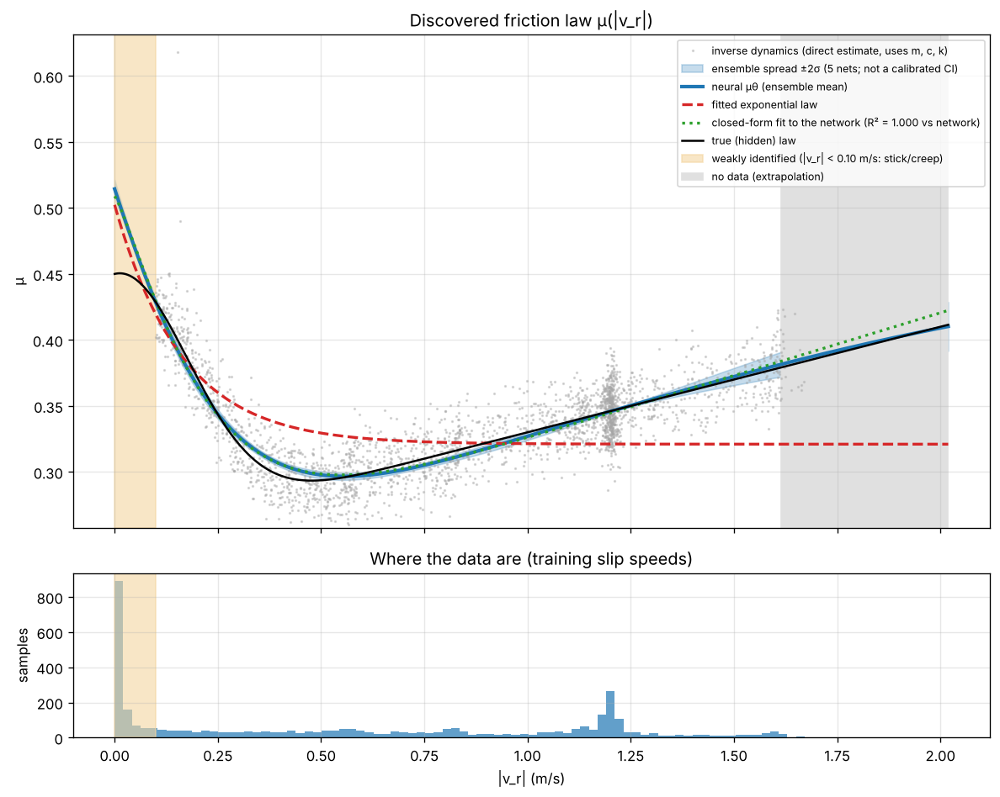

# Deep Learning for Friction-Induced Vibration

**Differentiable stick-slip simulation, robust damper design, neural surrogates, a Fourier neural operator and hybrid neural-ODE friction-law discovery, in PyTorch.**

Vikash Kumar, Department of Mechanical Engineering, Indian Institute of Technology Kanpur

Full write-up: [`Friction_Vibration_DL_Project_Report.pdf`](Friction_Vibration_DL_Project_Report.pdf) (22 pages)



## What this project does

A one-degree-of-freedom mass on a moving belt, with velocity-weakening friction, is the classic model of stick-slip vibration (brake squeal, slide-way chatter). This repository builds a validated, differentiable simulator of that system and uses it to test where deep learning genuinely helps:

| Component | Result |
|---|---|
| Differentiable RK4 simulator (PyTorch) | Matches SciPy Radau to a relative error of 1.1 × 10⁻⁵ |
| Robust damper design by stochastic gradient descent with gradient clipping | Sustained stick-slip on unseen operating conditions cut from 93.3% to 3.0% |
| MLP surrogate + stick-slip classifier | R² = 0.999 for vibration level; 99.2% regime accuracy against 97.1% for linear stability theory (the gap is a confirmed bistable band) |
| 1D Fourier neural operator, time-varying belt speed → full response | 6.8% median velocity error on unseen speed profiles |
| Hybrid neural ODE that learns an unknown friction law from noisy vibration records | RMSE of 0.0041 in μ, seven times better than a fitted exponential law; correct regime at unseen speeds |

The report also states the limitations: synthetic data only, weakly identified static friction, and an ensemble spread that is not a calibrated confidence interval.

## Repository layout

| File / folder | What it is | Report sections |
|---|---|---|
| `Friction_Vibration_DL_Project_Report.pdf` | Project report | all |
| `friction_vibration_dl.ipynb` | Executed notebook: simulator, robust SGD design, MLP surrogate, FNO (about 25 min on a CPU) | 3–6 |
| `friction_law_discovery.py` | Hybrid neural-ODE friction-law discovery; runs on the demo or on your own rig data (about 25 min; `--quick` about 10 min) | 7–8 |
| `reproduce_original_flaws.py` | Reproduces the review of the 2024 version (Fig. 1 of the report, about 2 min) | 2 |
| `figures/` | Report figures from the notebook and the 2024 review | 2–6 |
| `friction_outputs/` | The 11 friction-discovery plots, `summary.json`, `learned_friction_curve.csv`, trained `models.pt` | 8 |
| `example_rig_data/` | Example input folder in the exact format for real rig measurements | Appendix A |
| `legacy_2024/` | The first version of this project (August 2024): notebook, report and README, kept unchanged | 2 |

## Quick start

Requires Python 3.9+ with PyTorch, NumPy, SciPy and Matplotlib (plus Jupyter for the notebook). A CPU is enough.

```bash
# notebook, executed in place with all outputs saved
jupyter nbconvert --to notebook --execute --ExecutePreprocessor.timeout=10800 friction_vibration_dl.ipynb --output friction_vibration_dl.ipynb

# friction-law discovery on the synthetic demo (writes ./friction_outputs)
python friction_law_discovery.py --demo
python friction_law_discovery.py --demo --load friction_outputs/models.pt   # replot only, no training

# your own rig data: c and k from a separate test
python friction_law_discovery.py --data example_rig_data --m 1.0 --k 20 --c 0.2

# review of the 2024 version
python reproduce_original_flaws.py
```

Results on another machine may differ in the last digits (PyTorch version, CPU vs GPU).

### Data format for real measurements

`experiments.csv` lists one test per row; each test is a CSV with columns `t,x` (and `v` if measured), in SI units.

```csv
file,vb,N,role
run_015.csv,0.15,9.81,train
run_030.csv,0.30,9.81,train
run_065.csv,0.65,9.81,test
```

`vb` is the sliding speed at the contact (for a disc, ω·r at the pin), `N` the normal load, and `role` is `train` or `test`. Test runs are never used for training or model selection.

## History

The first version of this project (August 2024, now in `legacy_2024/`) tuned the same system with finite-difference gradients. A later review found that its friction term injected energy, that there was no driving belt, that its gradients were solver noise, and that its R² compared a prediction with itself. The November 2026 version corrects all of these; Section 2 of the report documents each defect with evidence.

## Citation

```
Vikash Kumar, "Deep Learning for Friction-Induced Vibration: corrected modelling, robust design,
neural surrogates, neural operators and friction-law discovery", project report,
Department of Mechanical Engineering, IIT Kanpur, November 2026.
```
